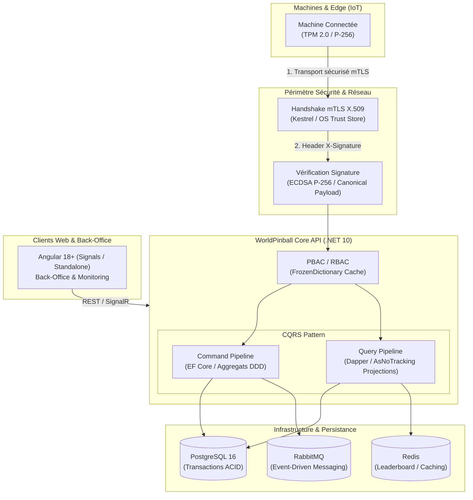
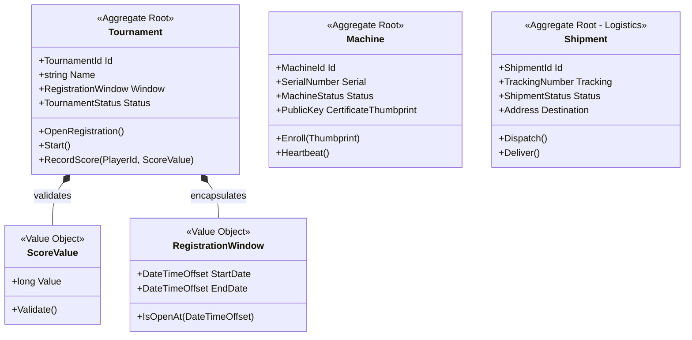

# WorldPinball API & IoT Platform

[](https://dotnet.microsoft.com/)
[-success)](#testing--quality)
[](#architecture)
[](#security--iot-pipeline)

Plateforme SaaS & IoT haute performance dédiée à la gestion, la télémétrie et le classement temps réel de flippers connectés.
Conçue selon les principes du **Domain-Driven Design (DDD)**, de la **Clean Architecture**, du **CQRS pragmatique** et du **TDD strict**.

---

## Architecture & Flux Système



---

## Modélisation Métier (Domain-Driven Design)



---

## Choix d'Ingénierie & Décisions Techniques

### Sécurité & Pipeline IoT Anti-Triche
- **Double Barrière de Confiance** :
  - **Couche Transport (mTLS X.509)** : Authentification mutuelle matérielle gérée au niveau Kestrel/Socket.
  - **Couche Applicative (Signature ECDSA P-256)** : Vérification cryptographique de chaque payload de score (`BuildCanonical` : timestamp, nonce, payload hash) pour garantir l'intégrité et la non-répudiation des parties.
- **Autorisations Haute Performance (PBAC)** :
  - Contrôle d'accès basé sur les permissions granulaires.
  - Mise en cache en mémoire via `FrozenDictionary<string, FrozenSet<string>>` garantissant des lookups en O(1) lock-free avec zéro allocation GC.

### CQRS Pragmatique & Performance Mémoire
- **Écriture (Commands)** : Encapsulation stricte du domaine avec Value Objects (`ScoreValue`, `TournamentId`), règles d'invariants et persistance via Entity Framework Core.
- **Lecture (Queries)** : Requêtes Dapper et projections optimisées `.AsNoTracking().Select(...)` sans surcharge d'entités de suivi.
- **Optimisation Mémoire** : Utilisation de `Span<T>` et `ref struct` pour le parsing zero-copy des signatures et buffers.

### Modularité & Bounded Contexts
- Architecture en modules indépendants (Clean Architecture) :
  - `WorldPinball.Api` & `WorldPinball.Core` : Gestion du jeu, tournois et classements.
  - `WorldPinball.Logistics` : Module autonome de gestion du cycle de vie matériel et expéditions.

---

## Qualité Logicielle & TDD

- **Couverture de Tests** : **496 tests automatisés (100% verts)** couvrant le Domaine, l'Application et l'Infrastructure.
- **Standards de Test** :
  - Méthodologie Test-First (TDD Red-Green-Refactor).
  - Structure Roy Osherove AAA (`Arrange`, `Act`, `Assert`).
  - Nommage explicite : `Method_StateUnderTest_ExpectedBehavior`.
  - Isolation via **NSubstitute** et assertions expressives via **FluentAssertions**.

---

## Stack Technique

- **Langage / Framework** : C# 14 / .NET 10 (ASP.NET Core Minimal APIs)
- **Accès Données** : Entity Framework Core 9 / Dapper / Npgsql
- **Bases de Données & Cache** : PostgreSQL, Redis
- **Messaging** : RabbitMQ (AMQP)
- **Sécurité** : mTLS, ECDSA (BouncyCastle / System.Security.Cryptography), Keycloak (OpenID Connect / JWT)
- **Tests** : xUnit, FluentAssertions, NSubstitute, WebApplicationFactory
- **Frontend** : Angular 18+ (Signals, Standalone Components, Reactive)

---

## Démarrage Local

```bash
# 1. Cloner le repository
git clone https://github.com/Surt7/WorldPinballApi.git

# 2. Lancer l'infrastructure (PostgreSQL, RabbitMQ, Redis)
docker compose up -d

# 3. Exécuter l'ensemble de la suite de tests
dotnet test --logger "console;verbosity=normal"

# 4. Lancer l'API
dotnet run --project src/WorldPinball.Api
```
